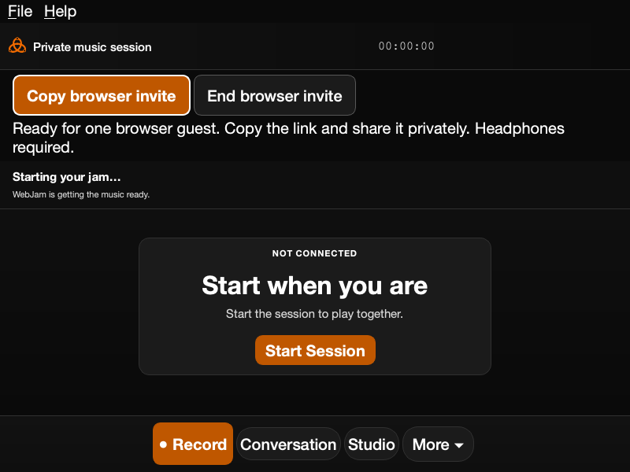

# Browser guest host readiness

The physical Intel MacBook's e101465 private package started native audio with
its built-in microphone and wired headphones at48kHz. Creating a browser invite
then failed with PREPARE_UNAVAILABLE. The user ended the session; a subsequent
process observation found no native audio children. This was not a reciprocal
browser music pass.

Read-only inspection found no libwebjoin_opus.dylib in that actual Mac package.
The unrelated system Opus library did not export the custom-mode functions.
The optional spec block plus the missing codec-build step allowed an app that
advertised browser guests to ship without their audio bridge dependency. This
is a demonstrated blocker, not proof that every later stage already works.

## Correction

- Require the custom-mode codec in every Mac host package. The existing pinned
  Opus1.5.2 builder verifies the source archive SHA256, runs its checks, retains
  COPYING/provenance/source, and signs the newly compiled dylib after changing
  its install name. It never signs or modifies an installed app.
- The normal application package matrix invokes that builder before PyInstaller.
  The actual resulting bundle must contain the owned codec and notices, have
  the correct architecture, and pass real custom128-frame and browser960-frame
  encode/decode checks through the explicit bundled library path. No microphone,
  speaker, media relay or network connection opens in that smoke check.
- Frozen apps refuse missing owned libraries instead of falling back to a
  machine's unrelated Opus installation. Source development keeps its existing
  explicit/system-library path.
- Music has a visible Invite a browser guest button, persistent status,
  Copy browser invite and End browser invite controls. Preparation failures use
  fixed stage-specific messages; private exception strings, keys and links are
  not displayed. The existing menu remains available.
- Permission remains off until the session owner requests it. Queued button
  events retain their original action/owner context; session replacement cannot
  retarget an old Copy or Stop click. Pending cleanup keeps its owner and retry
  action. Art and offline Reference Studio do not display Music invitations.

The screenshot intentionally renders a ready panel in an offline window to
inspect layout. It demonstrates presentation only: no actual invitation,
session, device capture or connection was created for the render.

## Validation and delivery boundary

120 focused source tests pass for controls, owners/cleanup, bridge framing,
package rejection, workflow wiring, compact Music layout and packaged data.
109 further existing profile/offline/compact follow-along checks pass. Ruff and
shell syntax checks pass. Compact800×600 controls/status fit at14px and20px;
the20px render was inspected. No skip or guard was added to obtain a pass.

Normal CI, a new matching private package cohort and actual bundled-codec ABI
execution are still required. Reusing the old e101 package, patching its app in
place or loading a system codec would not demonstrate this correction. Native
and browser Paint Along changes are separate application PRs. No release tag,
public navigation, signing enrollment, StoryPool/Karen dispatch or shared core
change is part of this fix.

After private delivery, retry one approved host/browser pair with headphones,
current account headroom, bounded capture and normal Stop/logout. Record human
hearing and network/platform scope separately. ARM-native hosting, Windows,
Ethernet comparison and separate-network music remain outstanding; an Intel
native host with a Mini browser guest does not replace those trials.
