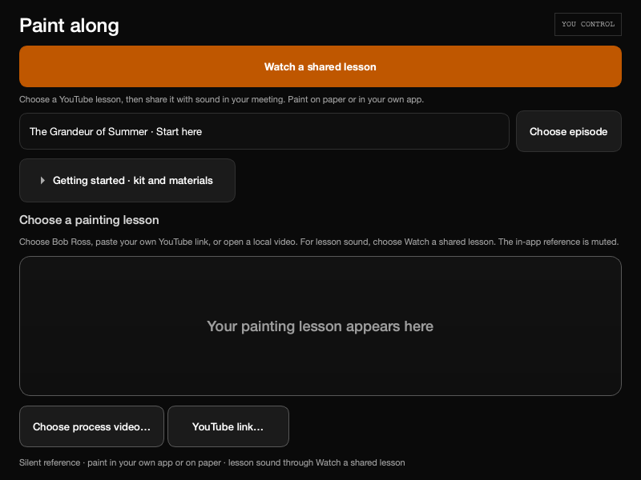

# Paint Along: Bob Ross and custom lessons

The intended experience is painting together while watching and hearing a
YouTube lesson. Offer an editorial Bob Ross starter list and let hosts paste
another YouTube video link; a local reference file remains optional.

The desktop starter list uses official uploads:

- [A Walk in the Woods, S1 E1](https://www.youtube.com/watch?v=oh5p5f5_-7A)
- [Northern Lights, S8 E13](https://www.youtube.com/watch?v=vgbMONXc9Cs)
- [Grey Winter, S7 E11](https://www.youtube.com/watch?v=sS-hNYgDUak)
- [The Grandeur of Summer, one-hour special](https://www.youtube.com/watch?v=mT0RNrTDHkI)

Titles/IDs and channel ownership were checked against YouTube’s official oEmbed
metadata on November4,2026; all four identify Bob Ross’s official channel.
The first two offer a starting landscape and northern lights; the latter two
add a winter scene and a longer lesson. These are editorial choices.
These are starter picks, not a verified ranking of the best or most popular
videos. Availability and embedding remain subject to YouTube and the uploader.
The app links/embeds; it does not download or redistribute episodes.

Desktop: in Paint Along, choose an episode and click Choose episode, or use
YouTube link for another lesson. Both use the existing host-controlled lesson
transport and validation. Guests explicitly open the host's lesson. For sound,
choose Watch a shared lesson and follow Conversation's browser/meeting handoff.
The existing in-app reference player remains muted: this change does not claim
that the native embed now plays lesson audio. No microphone or meeting starts
merely by selecting an episode. Room retirement and loading disable episode
selection; stale requests cannot share into an ended room.

Website: the Bob Ross room already has episode buttons and a shared canvas.
The follow-up website change exposes its existing YouTube-link form to the host
in paint-along rooms as well as watch rooms. Guests follow the selected video;
host controls remain authoritative. Browser autoplay may require a local tap.

This source change does not update an already-open frozen app. It needs its
normal application CI and a newly qualified private build before device delivery.
Music readiness, public-site launch and actual provider/audio trials stay separate.

Validation for this change: 460 focused native/source cases pass, including
host/guest lesson behavior, retired-room requests, restored-room controls,
800×600 entry layout, keyboard, and platform door behavior. Ruff passes for the
changed runtime/new test files. The image is an offscreen source render, not a
new frozen-package, provider playback, or audibility claim. Earlier local test
collection failed on a Python environment without Qt and an incomplete sparse
checkout; subsequent runs used the existing Python3.11 Qt environment and this
isolated worktree's full sources. Intermediate old-copy assertions and a missing
retirement disable were corrected before the passing run.

The first exact-head CI job126863467423 (run41912505832, source7a6e091)
failed in test_art_left_out_rules: the short reference hint omitted its existing
silent-picture qualifier. The correction restores “Silent reference” beside
the separate lesson-sound path. The original decoded job log is retained
privately (271,407 bytes; SHA256
70d72753ea36ce3b384e1d295c7432ef3e0e50d503fee93049a09c3b6deff0f5).
The expanded460-case local run and refreshed inspected render pass; the new
exact head still requires normal CI. No fixture, skip, mute guard or workflow
was weakened to obtain that result.
