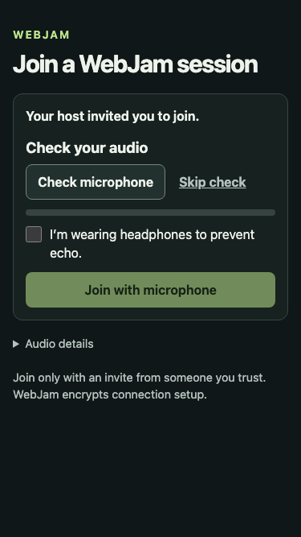
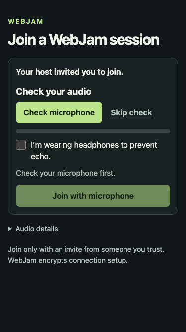

# Web Join readiness guidance

Make the microphone check the first prominent action. Explain the next step
instead of leaving a visitor to infer why Join is disabled. After microphone
detection, the page asks for headphones confirmation; once ready, it explains
that Join shares audio with the session. The Join button also references that
explanation for assistive technology. Capture, headphones, trust and admission
rules remain unchanged.

## Same initial state at 375px

| Before | After |
| --- | --- |
|  |  |

## Other reviewed states

- [Initial setup at 390px](after-initial-390.png)
- [Initial setup on desktop](after-initial-1280.png)
- [Microphone detected, headphones still required at 375px](after-headphones-375.png)
- [Microphone detected, headphones still required at 390px](after-headphones-390.png)
- [Explicit Skip check and headphones confirmed at 390px](after-ready-390.png)

These are local browser fixtures. The preview microphone is generated audio,
and the invitation values are existing public test constants. No physical mic,
real invitation, provider credentials or live music session are used. The ready
screenshot explicitly exercises Skip check; it is not a microphone-detection pass.

[Evidence and runtime content hashes](evidence.json) record five focused prejoin
passes, 44 Web Join unit passes and all 71 Chromium/WebKit browser cases. The new
baseline explanation assertion failed before implementation. A later full run
caught two old-copy expectations; they were updated without removing security
or cleanup checks, and the full suite then passed. Original failure evidence
remains private. Separate initial/reminder preview scenarios check viewport
bounds and zero capture for initial setup.

This is source/fixture evidence. Required GitHub CI, the website port and guarded
private delivery, physical audio, actual device/screen-reader behavior and
uncoached newcomer acceptance remain separate. No production setting, release
hold, public navigation, dependency or provider configuration changes here.
